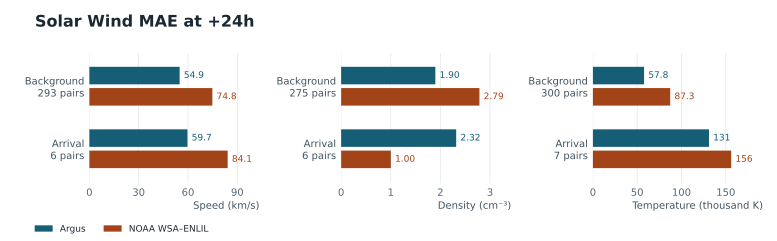
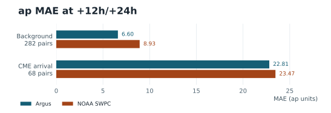
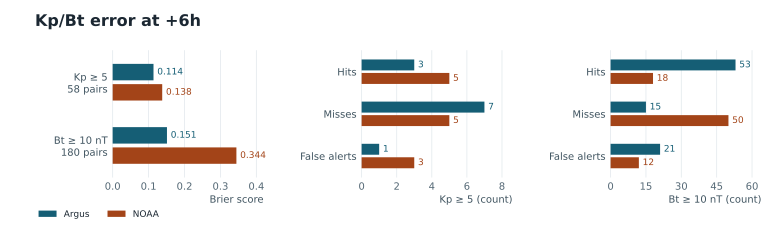
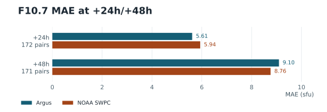

# Operational forecast comparison

[Methodology and details](METHODOLOGY.md)

January–June 2026 replay. **Background** excludes catalogued ICMEs and the following 24 h. **CME arrival** covers the first complete 6 h for L1 metrics and 12 h for geomagnetic indices. Pairs share targets and a cutoff. ENLIL availability is estimated from creation and archive timestamps for CME runs. [ICME catalog](https://spdf.gsfc.nasa.gov/pub/pre_generated_plots/ace/level3/icmetable2.html) · [NOAA WSA–ENLIL archive](https://registry.opendata.aws/noaa-wsa-enlil/)

## Wind and geomagnetic activity

Speed uses the DLinear fallback with CME correction. Paired 95% intervals favor Argus for background speed and density and include zero at arrival. Temperature compares Argus proton temperature with ENLIL single-fluid temperature.

Background ap uses +24 h. Arrival forecasts were issued at least 12 h before the front. NOAA ap is derived from the SWPC Kp bulletin. [SWPC forecast](https://www.swpc.noaa.gov/products/3-day-geomagnetic-forecast) · [Kp and ap definitions](https://kp.gfz.de/en/about-kp)

**Argus Dst at +24h**

| Regime | Pairs | MAE (nT) | 80% interval coverage |
| --- | ---: | ---: | ---: |
| Background | 3,429 | 10.26 | 84% |
| CME arrival | 193 | 22.61 | 56% |

NOAA Geospace forecasts Dst 30–60 min ahead. No public +24 h archive was found for the replay period. [NOAA Geospace](https://www.spaceweather.gov/products/geospace-geomagnetic-activity-plot)

## Fast updates after L1 detection

Complete intervals end within 6 h of issue. Argus assumes a 15-minute receipt delay and alerts at P ≥ 0.5. Brier scores use 0/1 probabilities for NOAA’s SWPC Kp and WSA–ENLIL Bt thresholds. ENLIL omits the ejecta’s internal field. [Fast Bt](frozen/2026-11-26-bt-fast-l1-v1/README.md) · [Fast Kp/ap](frozen/2026-11-26-kp-ap-fast-l1-v1/README.md) · [ENLIL cone model](https://doi.org/10.1088/0067-0049/213/2/21)

ap MAE by +6 h was 17.03 for Argus and 20.22 for NOAA (58 pairs, 95% CI for the difference includes zero). [Threshold scores](operational-comparison/threshold-horizons.csv)

## F10.7

The replay uses Penticton measurements from NOAA’s 22:00 UTC bulletin. Paired 95% intervals include zero on both leads. The table shows **Argus / NOAA** MAE in sfu, grouping CME arrivals by UTC date. [NOAA RSGA archive](https://www.ngdc.noaa.gov/stp/space-weather/swpc-products/daily_reports/reports_solar_geophysical_activity/) · [Scores](operational-comparison/f107-scores.csv) · [Provenance](operational-comparison/f107-provenance.json)

| Lead | Background MAE, sfu | Arrival-date MAE, sfu |
| --- | --- | --- |
| +24h | 5.50 / 5.95, 121 pairs | 6.94 / 6.81, 16 pairs |
| +48h | 8.83 / 8.95, 120 pairs | 9.99 / 9.19, 16 pairs |

## CME ETA and other outputs

- **CME ETA.** Argus uses NASA DONKI/WSA–ENLIL. Historical MAE on matched hits was 10.8 h for NASA M2M, 12.8 h for NOAA and 13.7 h for Met Office. [NASA Scoreboard, Table 3](https://doi.org/10.1029/2024SW003951)
- **Thermospheric density.** In the 2025 GRACE-FO replay at +24 h, JB2008 / DTM2020 with fixed drivers had MAPE 20.3% / 19.4% in background (902 pairs) and 36.1% / 26.8% in the first 12 h after arrival (254 pairs). [Model and observations](ATMOSPHERIC.md)
- **S10, M10 and Y10.** No paired operational evaluation by regime. [SET data](https://spacewx.com/current-data/)

[Scores and replay sources](operational-comparison/scores.csv)
