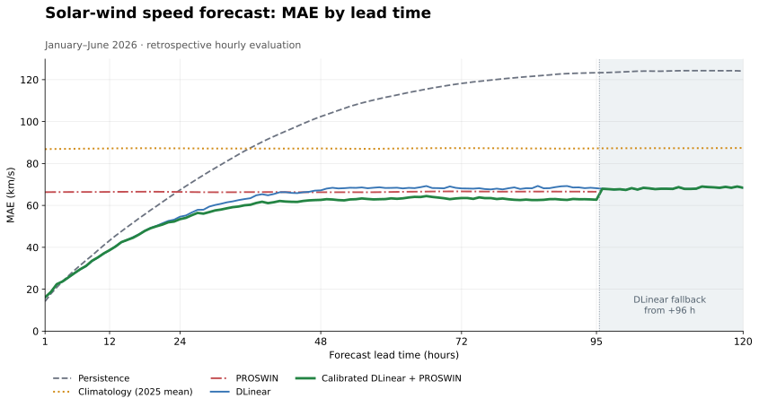

# Solar-wind speed — MAE comparison

Retrospective hourly evaluation, January–June 2026. DLinear trained through 2024; blend weights fitted on 2025. Persistence uses the last observed hour; climatology uses the 2025 mean.

All five methods use identical rows at +1…+95 h: 4,173–4,297 pairs per lead.

[PNG](solar_wind_speed_mae_2026.png) · [MAE data](mae_by_lead.csv) · [Provenance](provenance.json)

Source: `data/experiments/speed_dlinear_proswin_20261013T070431805471Z/`. [Training notebook](../../../../notebooks/solar-wind/train_speed_dlinear_proswin_2026.ipynb) · [Plot script](../../../../notebooks/workflows/revalidation/plot_speed_mae.py).
