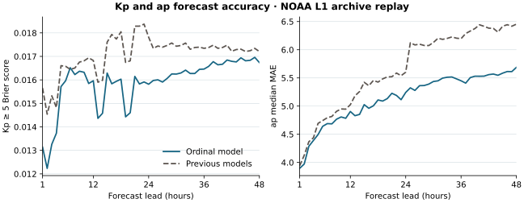

# Kp and ap forecast accuracy

`argus-geomagnetic-ordinal-v1` estimates Kp exceedance probabilities and three-hour ap quantiles from one distribution at +1…48 h. [Validation methodology](../../METHODOLOGY.md)

## L1 archive replay

Targets span 18 September–25 November 2026 UTC. The replay uses NOAA SWPC L1 wind, assumed observation delays and GFZ Kp/ap. September and October targets are definitive. November targets are preliminary. The paired sample contains 25,872 lead–target pairs across 1,662 issue times and 552 three-hour target intervals, including 9 with Kp ≥ 5. [Input timing](l1_protocol.json)

Mean across leads, previous → ordinal. Kp ≥ 5 Brier score 0.01709 → 0.01590, average precision 0.0353 → 0.1170, ap median MAE 5.66 → 5.14.



[Scores by lead](l1_by_lead.csv) · [API metrics snapshot](metrics.json) · [Sampled-lead confidence intervals](l1_sampled_intervals.csv) · [Provenance](provenance.json)

## OMNI archive comparison

Targets span 1 January–16 September 2026 UTC. OMNI wind is propagated to the bow shock. The NOAA comparison uses matched archived SWPC bulletins at +24 and +48 h and converts Kp point estimates to ap for scoring. [Lead scores and delay sensitivity](omni_by_lead.csv) · [Baselines and NOAA comparison](omni_noaa_comparison.csv)

## Reproduce the L1 scores

Run from the repository root with the local archive and model files listed in [provenance](provenance.json).

```sh
notebooks/.venv/bin/python -m notebooks.workflows.revalidation.geomagnetic_ordinal \
  data/revalidation/frozen/2026-11-26-kp-ap-v1/l1 \
  /tmp/argus-geomagnetic-metrics.json /tmp/argus-geomagnetic-comparison.csv
```
