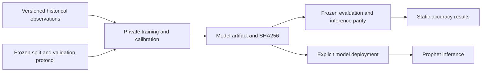

# Training and artifact delivery

Training, calibration and detailed experiments live in private notebooks/backends.
Public services load frozen artifacts; they do not fit models.

[Validation protocol](../../accuracy/METHODOLOGY.md) · [Operational verification](verification.md)
